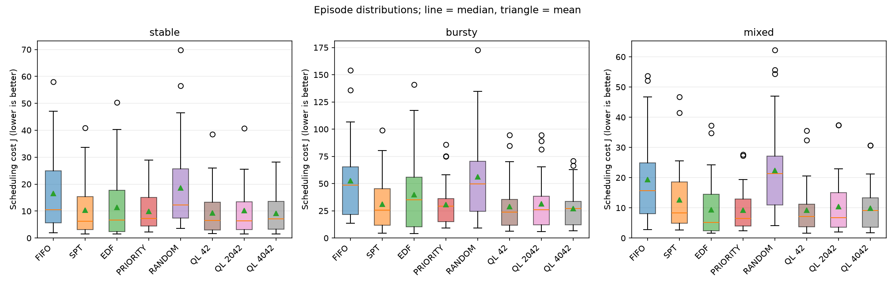

# AdaptiveQueue

## Overview

AdaptiveQueue is a lightweight Python project for comparing background job
schedulers. A single worker must handle jobs with different processing times,
priority weights, and deadlines: a long backup can delay a short, urgent task.
The project investigates whether learning to switch between established scheduling
rules reduces scheduling cost compared with using one rule throughout an episode.

## How the scheduler works

Jobs execute one at a time without preemption. When the worker becomes idle, the
tabular Q-Learning meta-scheduler selects **FIFO, SPT, EDF, or Priority**; that rule
chooses the next job. The agent observes only waiting jobs and the current time,
using buckets for queue length, deadline slack, short-job proportion, and whether
high-priority work is waiting. It cannot inspect future arrivals.


Training uses the negative cost of each completed job as reward. Evaluation uses
greedy actions with exploration and learning disabled. FIFO, SPT, EDF, Priority,
and seeded Random can also run as standalone baselines.

## Experimental results

The primary objective is to minimize
`J = mean(priority_weight * (tardiness + 0.1 * flow_time))`.
Deadline-miss rate, waiting time, and flow time are secondary metrics.

Three models trained independently on `mixed` workloads for 1,000 episodes each.
The table shows mean J over 30 matching evaluation seeds per workload, with all
three training runs kept separate:

| Policy / training seed | Stable | Bursty | Mixed |
| --- | ---: | ---: | ---: |
| Priority | 9.852 | 30.867 | 9.212 |
| Q-Learning / 42 | 9.270 | 28.804 | 9.284 |
| Q-Learning / 2042 | 10.164 | 31.471 | 10.402 |
| Q-Learning / 4042 | 9.210 | 27.130 | 9.900 |

Priority is the strongest classical baseline on mean J in all three tested
workloads. Two RL models outperform it on stable and bursty workloads, but all
three have higher mean cost on mixed workloads. SPT achieves the lowest mean
deadline-miss rate across all three workloads.



See the [full experimental analysis](docs/experiments.md) for all baselines,
secondary metrics, paired comparisons, and limitations. The
[summary CSV](benchmarks/default/summary.csv),
[per-episode CSV](benchmarks/default/per_episode.csv), and
[action frequencies](benchmarks/default/action_distribution.csv) retain the data
behind these comparisons.

## Quick Start

Use Python 3.10 or newer from the repository root. Simulation and learning have
no runtime dependencies; plotting uses the optional Matplotlib extra.

```sh
python -m venv .venv
source .venv/bin/activate
python -m pip install -e .
adaptivequeue --workload mixed --policy edf --seed 42
```

Train and evaluate a model on held-out workload seeds:

```sh
adaptivequeue train --workload mixed --episodes 1000 --seed 42 --output policy.json
adaptivequeue evaluate --workload mixed --episodes 20 --model policy.json
```

Evaluation defaults to seeds following the saved training range. Reproduce the
fixed benchmark with all five baselines and three independently trained models:

```sh
python -m pip install -e '.[benchmark]'
adaptivequeue benchmark --output-dir benchmark-results
```

Benchmark models are cached in the output directory; `--retrain` regenerates them.
Use `adaptivequeue --help`, `adaptivequeue train --help`, or
`adaptivequeue evaluate --help` for workload and learning options.
`python -m adaptivequeue` also works as the command entry point.

## Implementation and documentation

The typed Python package uses immutable job records and one shared simulation
engine for complete episodes and individual scheduling steps. Q-tables use
versioned JSON. CSV aggregation uses the standard library; Matplotlib is used
only for benchmark figures.

- [Simulation rules, state thresholds, and metrics](docs/simulation.md)
- [Experiment protocol and interpretation](docs/experiments.md)
- [Reference outputs and saved Q-tables](benchmarks/default)
- [Source code](src/adaptivequeue) and [focused tests](tests)

Run the existing checks locally; GitHub Actions runs them on Python 3.10 and 3.12
and verifies that the built wheel installs and runs:

```sh
python -m pip install -e '.[dev,benchmark]'
python -m pytest
ruff check .
ruff format --check .
mypy
```

## License

[MIT](LICENSE).
